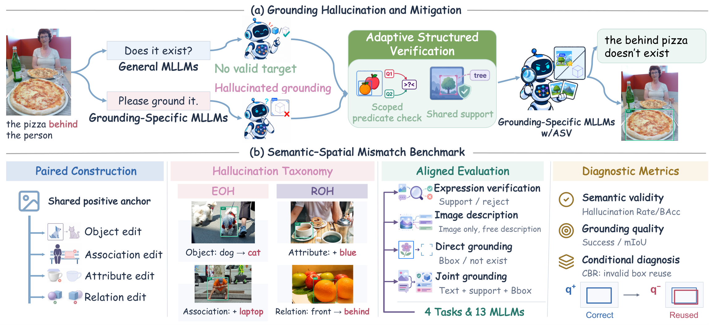
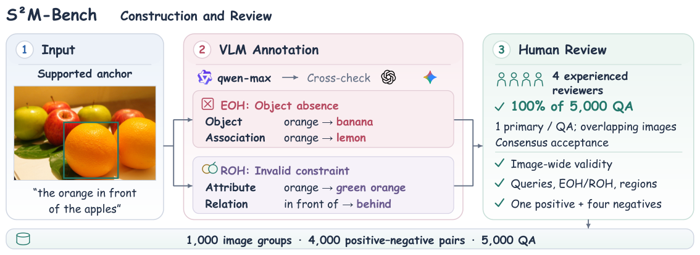
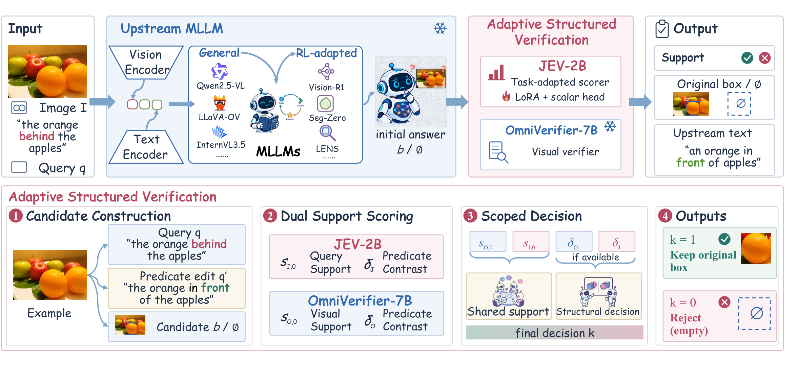
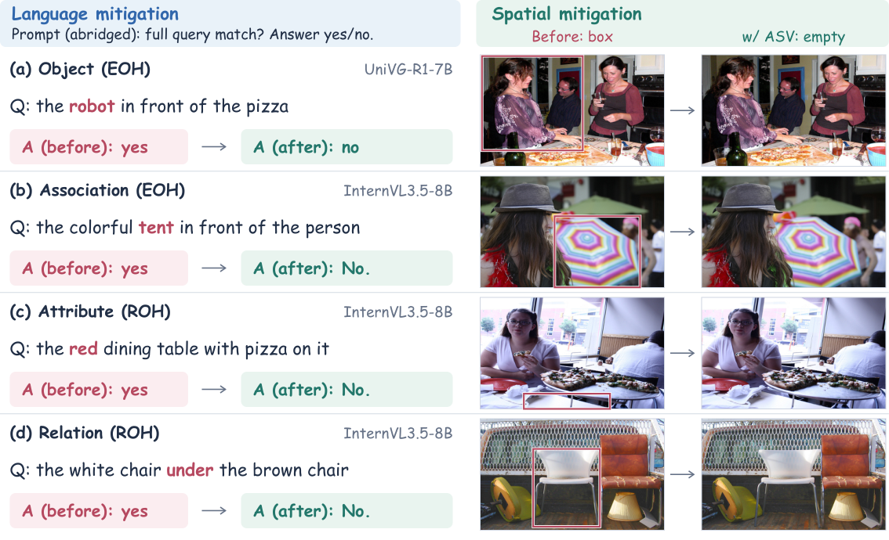

<div align="center">

# RRWR
## Right Region, Wrong Reference: Diagnosing Unsupported Grounding in MLLMs

<span class="author">An Yibo<sup>1</sup></span>,
<span class="author">Zhonghao Yan<sup>1,2,†</sup></span>,
<span class="author">Yuxuan Yang<sup>1</sup></span>,
<span class="author">Hao Chen<sup>3,†</sup></span>,
<span class="author">Ruoyan Jing<sup>1</sup></span>,
<span class="author">Muxi Diao<sup>1,2</sup></span>,
<span class="author">Kongming Liang<sup>1,2</sup></span>,
<span class="author">Zhuqing Jiang<sup>1</sup></span>,
<span class="author">Zhanyu Ma<sup>1,2</sup></span>,
<span class="author">Aidong Men<sup>1</sup></span>

<p><sup>1</sup> Beijing University of Posts and Telecommunications</p><p><sup>2</sup> Beijing Key Laboratory of Multimodal Data Intelligent Perception and Governance</p><p><sup>3</sup> Chinese University of Hong Kong</p>

<sup>†</sup> Project Lead

[**Paper**](downloads/paper.pdf) · [**Project Page**](https://salah-sudo233.github.io/rrwr-project-page/) · [**Appendix**](downloads/appendix.pdf) · [**BibTeX**](downloads/citation.bib)

</div>

## 🌟 Introduction

Multimodal large language models (MLLMs) can predict plausible bounding boxes even when no instance satisfies the complete referring expression. We term this failure <strong>Semantic–Spatial Mismatch</strong>: semantic support is absent, yet a spatial commitment is made. To study it, we introduce <strong>S<sup>2</sup>M-Bench</strong>, a paired benchmark that shares each positive anchor across four unsupported edits and aligns four tasks on the same items. <strong>Existential Object Hallucination (EOH)</strong> occurs when a required object is absent. <strong>Referential Object Hallucination (ROH)</strong> occurs when visible objects fail to satisfy requested attributes or relations. We further propose <strong>Conditional Box Reuse (CBR)</strong> to analyze pairs with correctly grounded positive expressions. It measures how often the unsupported counterpart receives a box overlapping the positive prediction. Across 13 MLLMs, 4 General MLLMs and 9 Grounding-Specific MLLMs have comparable positive grounding. Their mean direct-grounding false-grounding rates are 37.64% and 68.83%, respectively. CBR reveals unsupported reuse of correctly grounded positive boxes. ROH is harder to reject than EOH under explicit queries, whereas query-free captions show the reverse ordering. We propose <strong>Adaptive Structured Verification (ASV)</strong> to reduce unsupported assignments. ASV checks complete-expression support and selectively compares competing relation predicates to filter candidate boxes without changing their coordinates. ASV lowers the mean direct-grounding false-grounding rate from 59.23% to 19.03% while retaining 91.83% of initially correct groundings.



## 🗂️ S²M-Bench

Each supported query anchors four semantic edits: Object and Association (EOH), and Attribute and Relation (ROH). Model-generated annotations undergo cross-checking and human review. Each accepted group contains one positive query and four negative queries.



| Property | Value |
| --- | --- |
| Image groups | 1,000 |
| Positive–negative pairs | 4,000 |
| Image–expression items | 5,000 |
| Models | 4 General + 9 Grounding-Specific MLLMs |
| Tasks | Verification, Captioning, Direct Grounding, Joint Grounding |

## 🔎 Adaptive Structured Verification

ASV filters candidate boxes through complete-expression support scoring and selective predicate comparison. It retains the original coordinates or returns an empty output. JEV and frozen OmniVerifier supply support and predicate contrasts on the same image and candidate.



## 📊 Experimental Results

| Metric | Unfiltered | Shared support | ASV |
| --- | ---: | ---: | ---: |
| FGR ↓ | 59.23 | 22.55 | **19.03** |
| EOH FGR ↓ | 48.11 | 12.20 | **11.71** |
| ROH FGR ↓ | 70.36 | 32.89 | **26.36** |
| Relation CBR ↓ | 42.79 | 27.14 | **19.05** |
| Correct-grounding retention ↑ | **100.00** | 94.26 | 91.83 |
| All-positive mIoU ↑ | **0.4268** | 0.4011 | 0.3914 |

Means weight 13 models equally. Rates are percentages; mIoU is in [0,1]. Calibration targets 0.95 retention. Candidates, original positive eligibility, and reference boxes are fixed.

[Four-task benchmark results (CSV)](downloads/benchmark-results.csv) · [Per-model ASV results (CSV)](downloads/results.csv)

## 🖼️ Qualitative Analysis

Left: a separate verifier-feedback probe corrects the same MLLM's verification answer. Right: ASV rejects its Direct-G candidate. Complete prompts and attention maps are available in the appendix and the project's four-case viewer.



## 📚 Citation

```bibtex
@misc{an2026rrwr,
  title={Right Region, Wrong Reference: Diagnosing Unsupported Grounding in MLLMs},
  author={An, Yibo and Yan, Zhonghao and Yang, Yuxuan and Chen, Hao and Jing, Ruoyan and Diao, Muxi and Liang, Kongming and Jiang, Zhuqing and Ma, Zhanyu and Men, Aidong},
  year={2026},
  url={https://salah-sudo233.github.io/rrwr-project-page/}
}
```

## Website source

This repository hosts the paper project page and manuscript resources. Model code and benchmark downloads are not included in this release. Open `index.html` directly or use a static server; no build step is required. GitHub Pages publishes `main` from the repository root.

Research text, active table values, captions, and figures are sourced from `_NAACL2027__RRWR_Arxiv.zip` supplied by the authors. Provenance is recorded in [content-source.json](content-source.json). The included PDF is compiled from that supplied source; the web author block follows the user's specified names, affiliations, and Project Lead annotations. The source PDF itself retains its original manuscript author block.

Paper figures and source images retain their original rights and attribution.
